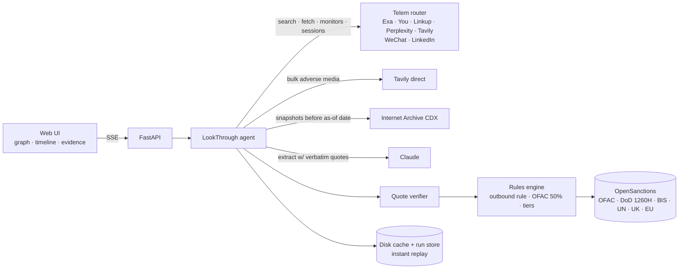

# LookThrough

**When a deal blows up, everyone asks one question: "What did you know, and when?"** The board, investors, regulators, lawyers and insurers all ask it. Today, answering takes weeks of analysts and lawyers, and AI search makes it worse, because it answers with hindsight.

**LookThrough rebuilds what was publicly knowable about any company on any past date, in about 90 seconds:**
- **Time-bounded:** only sources public on that date.
- **Verified:** every claim carries a verbatim quote checked against its source.
- **Connected:** investors, owners and subsidiaries are mapped live.

Built in one day at **SearchHack** on Telem's multi-engine search router.

> Screening signals for review, not legal advice.


## Who it's for
Anyone who signs off on risk:
- **investors** (15,352 US VC deals in 2025), plus PE and M&A;
- **banks and fintechs** ($206B a year on financial-crime compliance, LexisNexis 2023);
- **insurers, auditors and law firms**, whose claims, audits and lawsuits turn on "what was known at the time";
- **AI agents** that backtest or recommend decisions. Research shows date-filtered retrieval alone still leaks the future.

**First wedge:** investor due diligence. **Platform:** an API and MCP tool any agent can call.

## What it does

*Built-in screening goes beyond web evidence: sanctions and government lists (OFAC, DoD 1260H, BIS, UN, UK, EU) with listing dates, the OFAC 50% ownership rule, and US outbound-investment rule tests for cross-border deals.*


1. **Look-through graph.** From a target, it walks up through owners and investors and down through subsidiaries and portfolio companies, discovering edges live from the web.
2. **Evidence-grounded claims.** The LLM only *extracts*; every fact must carry a verbatim quote, and the quote is checked against the fetched page. Unverified claims are dropped (typically 96–100% survive).
3. **Deterministic rules decide.** Not "the model said so":
   - outbound-rule country and sector tests, including aggregate PRC ownership with undisclosed stakes;
   - OFAC 50% aggregation;
   - watchlist severity tiers (binding vs. restrictive) with listing dates.
4. **As-of mode.** Search is restricted with Telem `published_before`. Undated pages are admitted only through Internet Archive snapshots captured before the date. Watchlist hits must have been listed by then.
5. **Timeline: knowable vs. acted.** Dated signals (list additions, regulator actions) sit beside dated stakeholder actions (funding rounds, relocations, acquisitions). Drag the slider to a decision date and see what was already public.
6. **Continuous monitoring.** One click turns a flagged entity into an hourly Telem Monitor.

## Case study: Builder.ai
Builder.ai was the "AI" app-builder backed by Microsoft, SoftBank's DeepCore and Insight Partners, and it collapsed into insolvency in 2025. What was public **before** the 2023 rounds:

| Date | Public signal |
|---|---|
| 2019-02 | Former chief business officer sues, alleging investors were told the product was 80% built |
| 2019-08 | WSJ: the company "exaggerates its AI capabilities to attract customers and investors" |
| 2019-08 | The Verge: "uses human engineers in India and elsewhere to put together the app" (machine-verified) |
| 2020-06 | Business Insider: cloud resale "thought to account for a chunk of its revenue" |
| 2022-03 | Insight Partners still leads a $100M Series C |

**Hindsight test:** asked "as of 2023-05-01", plain Claude search brought up the 2025 insolvency, cited a 2025 bankruptcy article, and used its "own recall". LookThrough stayed inside the window and verified its quotes. See [docs/claude-code-demo.md](docs/claude-code-demo.md).

## How Telem is used

| Need | Telem feature |
|---|---|
| Multi-engine retrieval | `auto_routing: "accuracy"`: Telem classifies each query (e.g. *companies* → Exa/You/Linkup, *financial_filings* → Exa/Perplexity/Tavily) |
| Point-in-time search | `published_before` on every query in as-of mode; `extended` tier for publish dates |
| Chinese-language evidence | Pinned `socialdatax_wechat` provider (WeChat public accounts) |
| People and teams | Pinned `apify_linkedin` provider |
| Reading sources | Telem Fetch with cross-fetcher fallback; page `sha256` stored as evidence hash |
| Audit trail | One Telem **session** per look-through, traced in the Telem console |
| Ongoing compliance | Telem **Monitors** (hourly, agent-checked) on flagged entities |

Cross-engine consensus ranking means URLs returned by more engines and queries are read first.

## Architecture



## Use it from any agent (MCP)

LookThrough's primitives ship as an MCP server, so Claude Code, Cursor or any MCP client gets time-travel search:

| Tool | What it does |
|---|---|
| `time_travel_search(query, as_of)` | Telem-routed multi-engine search limited to what was public on `as_of`: dated sources after it are dropped, and undated pages are admitted only through Internet Archive snapshots captured before it |
| `verify_quote(url, quote, as_of)` | Checks a quote against the page, or against its archived as-of version, before the agent cites it |
| `screen_entity(name, as_of)` | Watchlist hits with severity tier and listing date, counting only listings in force on that date |

`.mcp.json` is included, so `claude` run from the repo root picks it up. See [docs/claude-code-demo.md](docs/claude-code-demo.md). Asked about Builder.ai as of 2023-05-01, Claude Code with these tools stayed inside the time window and verified its quotes; plain search leaked the 2025 insolvency.

## Run it

```bash
python3 -m venv .venv && .venv/bin/pip install -r requirements.txt
./scripts/download_lists.sh            # OpenSanctions data (CC BY-NC)
cat > .env <<EOF
TELEM_API_KEY=tlm_...
TELEM_BASE_URL=https://hack.telem.ai/api
TAVILY_API_KEY=tvly-...
EOF
.venv/bin/uvicorn app.server:app --port 8077   # open http://localhost:8077
```

The LLM runs through the local `claude` CLI, throttled (one call at a time, at least 3 s apart, at most 12 per minute) and cached. Set `LOOKTHROUGH_READONLY=1` for a public, replay-only instance.

## Code map

- `app/agent.py`: retrieve → rank → admit (as-of) → read → extract → verify → screen → expand
- `app/rules.py`: outbound-rule assessment, OFAC 50% aggregation
- `app/screening.py`: fuzzy watchlist matching, severity tiers, listing dates
- `app/search.py`: Telem + Tavily clients, cost meter, session tracking
- `app/wayback.py`: point-in-time page snapshots
- `web/index.html`: single-page UI (Cytoscape.js)

## Limits

- Private-company ownership percentages are rarely public. LookThrough reports "aggregate test undetermined" and names the shareholders to ask about, rather than guessing.
- Publish dates come from search providers and can be wrong; undated live pages are excluded from as-of runs.
- OpenSanctions data is CC BY-NC; commercial use needs a license.
